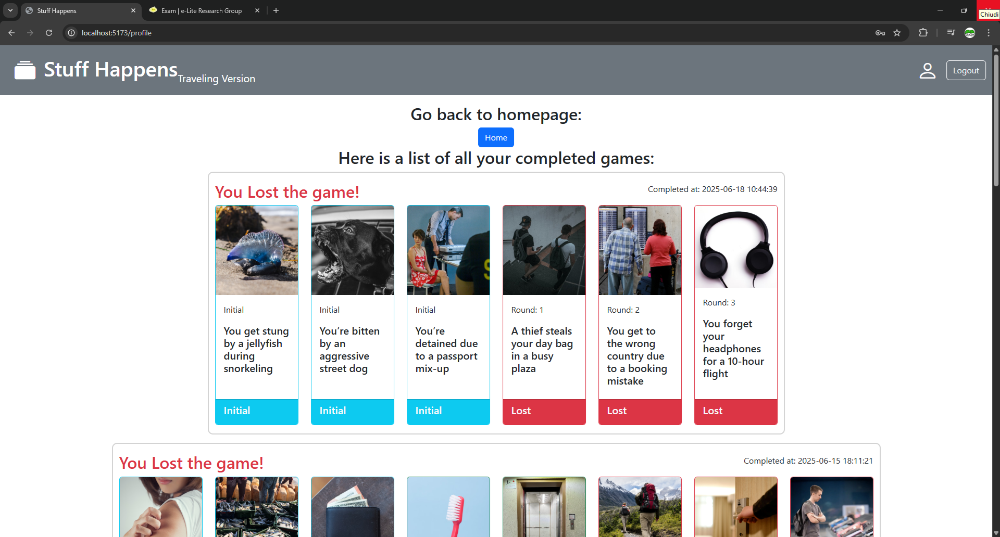
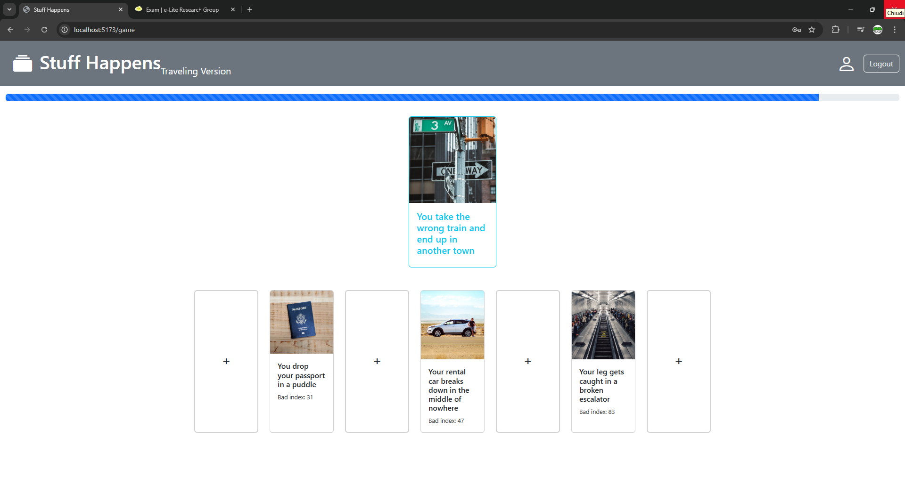

# Exam #1: "Stuff Happens"
## Student: s342937 OGGERO PAOLO 

## React Client Application Routes

- Route `/`: homepage, welcomes a logged in player and shows the rules for a not logged in player. A button so start a game is shown.
- Route `/login`: login contains the login form and allows the user to login.
- Route `/game`: game cantains the game itself, it shows the card to be guesses, all the cards the player currentry has and buttons to allow the user to play and go the the next round or to the end game page when the game is finished.
- Route `/end-game`: end-game contains the summary of the game just played, with all the cards won and their information.
- Route `/profile`: profile contains the list of all games played by the player with all the cards involved in the game, their status and the round they where guessed in.
- Route `*`: this page is where all other routes are redirected to and only contains a 404 page not found message.

## API Server

### User Authentication APIs
- **POST `/api/login`**
  - **Request Body:**
    - `username`: string
    - `password`: string
  - **Response Body:**
    - `id`: integer
    - `username`: string

- **GET `/api/session/current`**
  - **Request Parameters:** None
  - **Response Body:**
    - `id`: integer
    - `username`: string

- **DELETE `/api/logout`**
  - **Request Parameters:** None
  - **Response Body:** Empty

### Gameplay APIs
- **GET `/api/games/temp-game`**
  - **Request Body:**None
  - **Response Body:**
    - {cards: [card1, card2, card3], card_to_guess: card}
    - Object containing the three initial cards and the card to be guessed with index censored

- **POST `/api/games`**
  - **Request Body:**
    - {cards: [card1, card2, card3]}
  - **Response Body:**
    - `id`: integer
    - Saves the initial configuration of a game in db

- **GET `/api/games/:gameId/random-card`**
  - **Request Parameters:**
    - `gameId`: integer
  - **Request Body:**None
  - **Response Body:**
    - {card}
    - Object containing a card that is not already present in the game specified as parameter with index censored

- **POST `/api/games/:gameId/cards`**
  - **Request Parameters:**
    - `gameId`: integer
  - **Request Body:**
    - `id`: integer
    - `index`: integer
    - `round`: integer
  - **Response Body:**
    - {id: integer, title: string, image: string, bad_index: float, card_status: string, round: integer}
    - Saves a card in the game with id = gameId and returns the updated card with the card_status 

- **GET `/api/cards/:cardId`**
  - **Request Parameters:**
    - `cardId`: integer
  - **Request Body:**None
  - **Response Body:**
    - {id: integer, title: string, image: string, bad_index: float, card_status: string, round: integer}
    - retrieves the information of a card given its cardId

- **GET `/api/games/:gameId`**
  - **Request Parameters:**
    - `gameId`: integer
  - **Request Body:**None
  - **Response Body:**
    - {id: integer, user_id: integer, result: string, cards: [card1, card2, card3, ...], completion_time: string}
    - retrieves the information of a game given its gameId where all cards that are lost have censored index

### User game history APIs
- **GET `/api/users/:userId/games`**
  - **Request Parameters:**
    - `userId`: integer
  - **Request Body:**None
  - **Response Body:**
    - [game1, game2, ...]
    - retrieves all the games of a user given its userId, where the bad_index of a card is censored

## Database Tables

- **Table `Users`**
contains all users of the application
  - `id`: integer, primary key, unique
  - `username`: string, not null
  - `password`: string, not null
  - `salt`: string, not null

- **Table `Cards`**
contains all cards of the application
  - `id`: integer, primary key, unique
  - `title`: string, not null
  - `image`: string, not null
  - `bad_index`: string, not null

- **Table `Games`**
contains all games of the application
  - `id`: integer, primary key, unique
  - `user_id`: integer, not null
  - `result`: string, not null
  - `completion_time`: string, not null

- **Table `GameCards`**
contains the cards involved in a game with the related game_id, the status (Won, Lost, Initial) and the round they were interacted with.
  - `id`: integer, primary key, unique
  - `game_id`: integer, not null
  - `card_id`: integer, not null
  - `status`: string, not null
  - `round`: integer, not null

## Main React Components

- `TopNav` (in `TopNav.js`): contains the navbar always displayed that allows to login (if the user is not logged in), logout and navigate to the profile page (if the user is logged in) and to navigate to the home page.
- `Homepage` (in `Homepage.js`): landing page of the application constains a description of the game for not logged in users and a welcome message for logged in users. For both also a start game button is present.
- `LoginForm` (in `LoginForm.js`): contains the login form with a username and a password fields with a button to confirm and another one to cancel and go back to the homepage.
- `CardGame` (in `CardGame.js`): contains the actual game, displays the progress bar and two other components CardToGuess and CardsInPosses.
- `CardToGuess` (in `CardGame.js`): contains the card to be guessed, once the position has been guessed it shows the state of the card (won or lost) and a button to go the the next round.
- `CardsInPosses` (in `CardGame.js`): contains the card in the user possession (only initial cards and won cards), toghether with buttons to allow the user to select the position he/she thinks is right.
- `EndGame` (in `EndGame.js`): contains a summary of the game just played showing the cards won and their information with a button to go to the homepage. If you reach this page not from a game you will get a "you need to play a game for the recap" message.
- `Profile` (in `Profile.js`): contains all games of a user showing all cards involved in a game with the appropriate information.

(only _main_ components, minor ones may be skipped)

## Screenshot

### History screenshot:

### InGame screenshot:

## Users Credentials

- username: pippo, password: pippo
- username: pluto, password: pluto